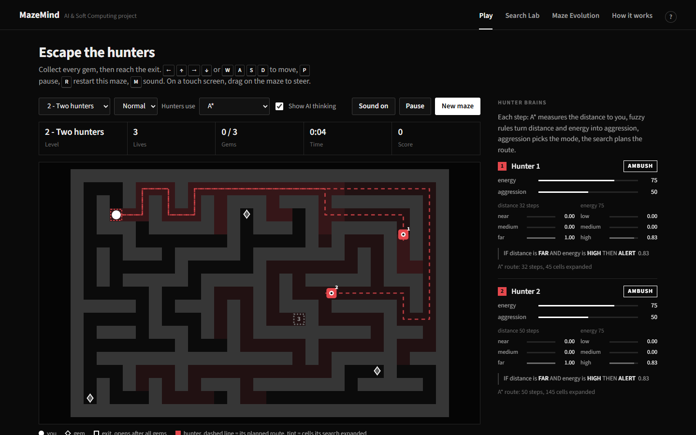
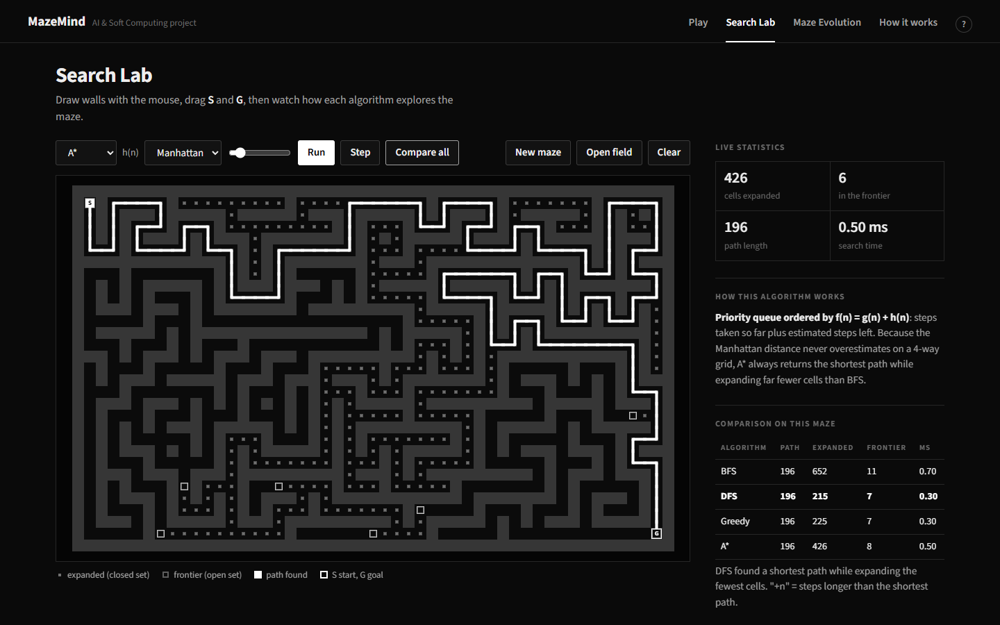
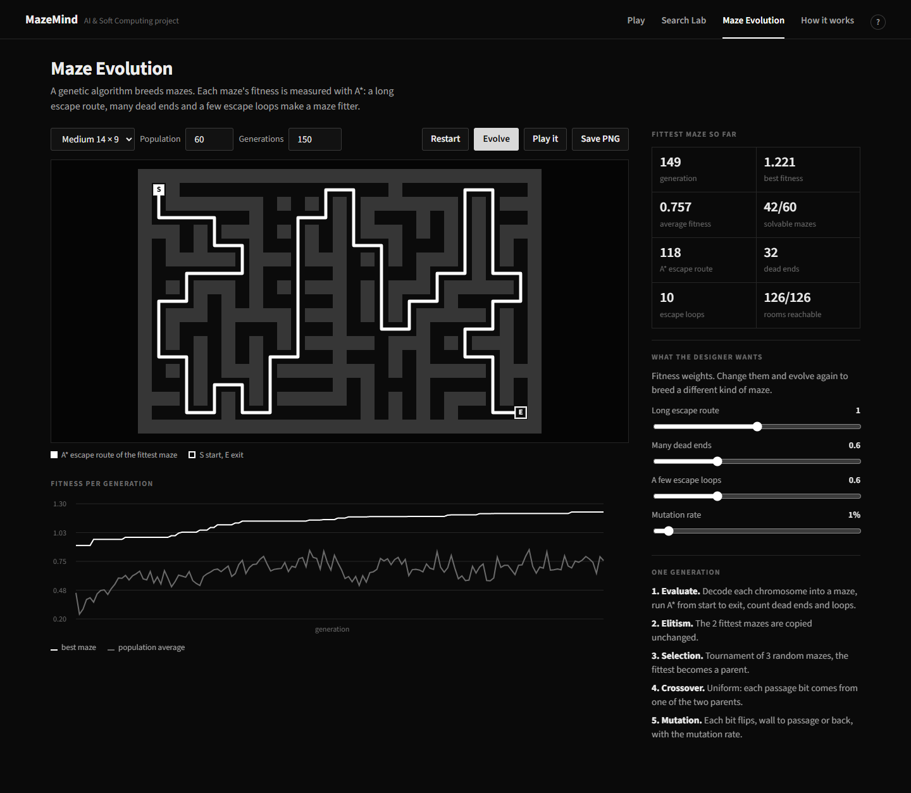
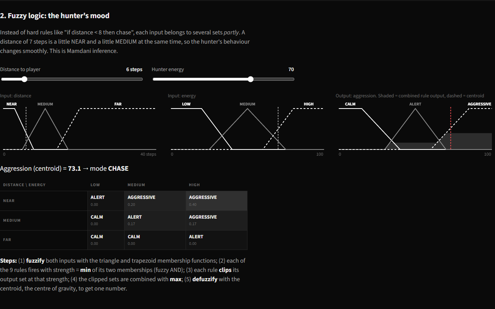

# MazeMind

A maze escape game where the enemies are controlled by AI. Collect the gems, reach the exit, and don't get caught by the hunters.

Made for the **Artificial Intelligence & Soft Computing** course.

**Play it here:** https://jasuuucreates.github.io/MazeMind/ (or just open `index.html`, no install needed)



## AI topics used

| Syllabus topic | Where it is in the project |
|---|---|
| Heuristic search (A*) | Every hunter plans its route to you with A*. A* is also the hunter's "sensor" for how far away you are. |
| Uninformed search (BFS, DFS) and greedy best-first | Search Lab compares all four on the same maze. In the game you can switch the hunters to BFS, DFS or greedy and see them behave differently. |
| Fuzzy logic | Decides how aggressive each hunter is from its distance to you and its energy (Mamdani inference, 9 rules). |
| Genetic algorithm | Evolves new mazes. The fitness of a maze is measured with A*. |

## Screens

**Play** - the game, 4 levels and 3 difficulties. The panel on the right shows each hunter's brain live: fuzzy inputs, the strongest rule that fired, its aggression, its mode and how many cells its search expanded. Tick "Show AI thinking" to see the planned routes (dashed) and the searched cells (tinted). Your best score per level is remembered, there are sound effects (M to mute), and on a touch screen you drag on the maze to steer.

**Search Lab** - draw walls, drag the start and goal, and watch BFS, DFS, greedy best-first or A* explore. "Step" expands one cell per click and explains it (for A*: g, h and f). After a search, point at any cell to see when it was expanded. "Compare all" runs all four and shows path length, cells expanded, max frontier size and time.



**Maze Evolution** - runs the genetic algorithm live with a fitness chart. You can change what the "designer" wants (long route, dead ends, loops), play the evolved maze ("Play it") or save it as a picture ("Save PNG").



**How it works** - explanation of all three parts, with an interactive version of the hunters' fuzzy controller (move the sliders, see which rules fire).



## How a hunter decides what to do

On every step a hunter:

1. **Senses** - runs A* to get the real distance to the player through the maze.
2. **Feels** - the fuzzy controller turns distance + energy into an aggression value (0 to 100).
3. **Decides** - aggression >= 62: CHASE, >= 38: AMBUSH (go to where the player is heading), otherwise PATROL, or REST if it is tired.
4. **Plans** - plans a route to its target with the selected search algorithm.
5. **Acts** - takes one step. Chasing uses energy, resting gets it back, so a hunter can't chase you forever.

## Search algorithms

All four are in `js/search.js`. Every move costs 1, the heuristic is the Manhattan distance.

| Algorithm | Frontier | Picks next | Shortest path? |
|---|---|---|---|
| BFS | queue | oldest cell | yes |
| DFS | stack | newest cell | no |
| Greedy best-first | priority queue | lowest h(n) | no |
| A* | priority queue | lowest f(n) = g(n) + h(n) | yes (Manhattan is admissible on a 4-way grid) |

Example from one random maze in the Search Lab:

| | path length | cells expanded |
|---|---|---|
| BFS | 144 | 586 |
| DFS | 176 | 188 |
| Greedy | 184 | 203 |
| A* | 144 | 475 |

A* finds the same shortest path as BFS but expands fewer cells. Greedy and DFS are fast here but their paths are longer.

## Fuzzy controller

`js/fuzzy.js`

- Inputs: **distance** (NEAR, MEDIUM, FAR) and **energy** (LOW, MEDIUM, HIGH), triangle and trapezoid membership functions.
- Output: **aggression** (CALM, ALERT, AGGRESSIVE).
- 9 rules, for example: IF distance is NEAR AND energy is HIGH THEN aggression is AGGRESSIVE.
- AND = min, implication = min (clipping), aggregation = max, defuzzification = centroid.

| distance \ energy | LOW | MEDIUM | HIGH |
|---|---|---|---|
| NEAR | ALERT | AGGRESSIVE | AGGRESSIVE |
| MEDIUM | CALM | ALERT | AGGRESSIVE |
| FAR | CALM | CALM | ALERT |

## Genetic algorithm

`js/genetic.js`

- **Chromosome:** one bit for each place where two neighbouring rooms could be joined (1 = passage, 0 = wall). A 14 x 9 maze has 229 genes.
- **Fitness:** a maze whose exit can't be reached scores below 0.25. A solvable maze scores 0.25 + reach² x (weighted mix of A* route length, dead ends and escape loops). Loops = passages - rooms + 1.
- **Operators:** elitism (best 2 kept), tournament selection (size 3), uniform crossover (0.9), bit-flip mutation (1%).
- The first generation is half normal generated mazes (recursive backtracker) and half random.

## Running it

- Open `index.html` in Chrome, Edge or Firefox. It works offline (the font is included).

| Key | Does |
|---|---|
| Arrow keys or WASD | move (hold to keep walking, press early to turn at the next corner) |
| P | pause |
| R | restart the same maze |
| N | next level, after you escape |
| M | sound on / off |
| ? | list of shortcuts |

The game pauses by itself when you switch to another tab or window.

Tests (needs Node.js 18 or newer, no packages to install):

```
npm test
```

61 tests for the grid, the four searches, the maze generator, the fuzzy controller, the game rules and the genetic algorithm. Some search tests run on 10 random mazes instead of one hand-made grid.

## Files

```
index.html          the page with all four screens
css/style.css
js/grid.js          grid, priority queue (binary heap), seeded random numbers
js/search.js        BFS, DFS, greedy best-first, A*
js/mazegen.js       recursive backtracker maze generator + braiding (adds loops)
js/fuzzy.js         fuzzy sets, Mamdani inference, the hunter's rule base
js/game.js          game rules and hunter AI
js/genetic.js       genetic algorithm for mazes
js/render.js        canvas drawing
js/sound.js         sound effects (Web Audio, no sound files)
js/ui-*.js          one file per screen
tests/              node --test unit tests
fonts/              Source Sans 3 (SIL Open Font License, see fonts/OFL.txt)
```

## Demo in 3 minutes

1. **Play**, level 2, "Show AI thinking" on. Point at the brain panel: distance and energy go in, a fuzzy rule fires, aggression comes out, aggression picks the mode.
2. Switch "Hunters use" to **DFS**: the dashed routes get long and wander. Switch back to **A\***.
3. **Search Lab**: press **Step** a few times and read the g, h, f line. Then **Compare all**: A* and BFS find the same shortest path, A* expands fewer cells, greedy and DFS find longer paths.
4. **How it works**: move the distance and energy sliders and watch the rules light up and the centroid move.
5. **Maze Evolution**: **Evolve**, watch the best fitness climb, then **Play it**.

## Team

Jasman Singh (2427030131) and Tapish Thakur (2427030132), B.Tech CSE, Manipal University Jaipur.

MIT License.
